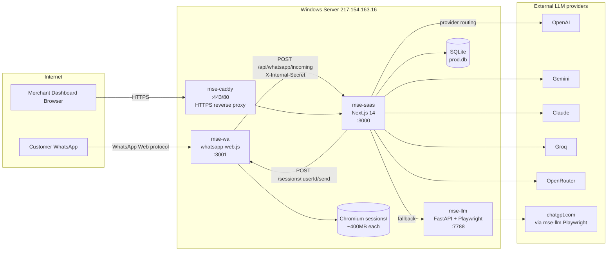

# Architecture

## Bird's-eye view

## Four services (all NSSM-managed on Windows)

### 1. `mse-saas` (Next.js 14, port 3000)
- **What:** the entire SaaS app — UI, REST API, Prisma DB access, business logic.
- **Stack:** Next.js 14.2.18, React 18.3, TypeScript 5.6, Prisma 5.22, Tailwind 3.4, Jose JWT, bcryptjs.
- **Entry points:**
  - Pages: `saas/app/**/page.tsx`
  - REST: `saas/app/api/**/route.ts` (44 route groups)
  - Cron: `saas/app/api/cron/{broadcasts,follow-ups,daily-report,llm-prewarm}/route.ts`
- **DB:** SQLite at `C:/app/saas/prisma/prod.db` (set via `DATABASE_URL`).
- **Internal auth between services:** header `X-Internal-Secret` = env `SAAS_INTERNAL_SECRET`.
- **Build:** `npm run build` → `prisma generate && next build` → `.next/` directory.
- **Start:** `next start -p 3000`.

### 2. `mse-wa` (Node.js, port 3001) — WhatsApp gateway
- **What:** multi-tenant WhatsApp client. One `whatsapp-web.js` Client per merchant, each owning its own Chromium.
- **Entry:** `whatsapp-service/src/index.js` (Express). Manager at `whatsapp-service/src/sessions.js` (488 lines).
- **Sessions:** `whatsapp-service/sessions/session-{userId}/` (LocalAuth persistence).
- **Limits (`WA_MAX_SESSIONS`, default 12):** each Chromium uses ~400 MB RAM. Sweeping idle sessions every 5 min, LRU-evict when over cap. See `whatsapp-service/src/sessions.js:30-48`.
- **Endpoints:** `/sessions/:userId/{start,status,pair,send}`, `/health`, `/sessions/stats`. All require `X-Internal-Secret`.
- **Incoming message webhook:** the gateway calls SaaS at `POST http://127.0.0.1:3000/api/whatsapp/incoming` for every customer message.
- **Restart-safe:** on boot, restores all sessions whose folders exist on disk.

### 3. `mse-llm` (Python, port 7788) — legacy in-house LLM
- **What:** OpenAI-compatible proxy that drives a Chromium logged into `chatgpt.com` (Playwright) and scrapes the HTML response.
- **Entry:** `main.py` (FastAPI). Endpoints: `/v1/chat/completions`, `/v1/responses`.
- **Profile:** persistent Chrome user data at `C:\app\chrome-profile`.
- **Status:** ⚠️ **fragile by design.** When the chatgpt.com session expires the service starts returning 500s and eventually `uvicorn` shuts down. See `audits/production-audit-summary.md` for the May 2026 incident.
- **Recommendation:** treat as a fallback. Production merchants should use an external provider (`openai`, `gemini`, etc.). UI for switching is at `/dashboard/settings/ai-provider`.

### 4. `mse-caddy` (Caddy 2, ports 80/443) — HTTPS edge
- **What:** reverse proxy + automatic Let's Encrypt cert renewal.
- **Config:** `C:\app\deploy\Caddyfile`.
- **Routes:** `app.keyone1.com` → `127.0.0.1:3000`.

## Data store

**SQLite** at `C:/app/saas/prisma/prod.db`, accessed exclusively via Prisma Client.

- Schema: `saas/prisma/schema.prisma` (565 lines, 18 models).
- Migrations: `prisma db push` (additive — never `migrate dev` in prod).
- Backups: snapshotted on every `deploy.ps1` run to `C:\app\backups\pre-deploy-<TS>\saas.db`.
- WAL mode is implicit (Prisma default).

**Why SQLite (still):** Single-VPS deployment, <50 merchants. See `SCALING_PLAN.md` for when to migrate.

## Trust boundaries

| Boundary | Mechanism | Failure mode |
|---|---|---|
| Internet → Caddy | TLS / firewall | none documented |
| Caddy → SaaS | localhost only | none |
| SaaS ↔ wa-service | `X-Internal-Secret` shared env | invalid secret → 401 |
| SaaS → external LLM | per-merchant API key, AES-256-GCM in DB | bad key → ProviderError, fallback in `lib/llm.ts` |
| Customer phone → DB | bot's `whatsappPhone` ≠ customer phone | self-send guard in `lib/notify.ts:isOwnWhatsappNumber` |
| Cron tasks → /api/cron | `X-Internal-Secret` | 401 if missing |

## Critical environment variables

See `saas/.env.example` and `deploy/env.*.example`. The non-obvious ones:

- `SAAS_INTERNAL_SECRET` — **must** be set in prod. Used everywhere.
- `LLM_API_URLS` — comma-separated list for round-robin (overrides `LLM_API_URL`).
- `LLM_MAX_CONCURRENT` — default 3, in-flight LLM cap.
- `WA_MAX_SESSIONS` — default 12, RAM-bound.
- `KB_CACHE_TTL_MS` — default 60_000, in-memory KB cache.
- `MEMORY_EXTRACT_EVERY` — default 20, msgs between background memory updates.
- `DATABASE_URL` — `file:./prod.db` (relative to `saas/`).

## Why these choices

| Decision | Reason | Tradeoff |
|---|---|---|
| Next.js App Router | All-in-one (UI + API + cron) on one process | larger build, longer cold-start |
| SQLite | Zero-ops, single-VPS | concurrent writers serialize; no replication |
| whatsapp-web.js (unofficial) | Cheap, no Meta approval | Chromium per session, risk of ban |
| Playwright LLM proxy | Free ChatGPT access | Session expiry; production hostile |
| NSSM (no Docker) | Native Windows-friendly, simpler RDP | manual orchestration |
| Per-merchant LocalAuth | True multi-tenant isolation | RAM cost ~400 MB / merchant |
