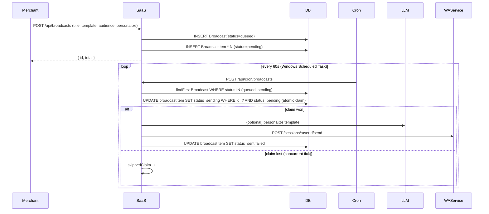

# Broadcast System

> Files:
> - API: `saas/app/api/broadcasts/route.ts` (create), `saas/app/api/broadcasts/[id]/route.ts` (status/cancel)
> - Worker: `saas/app/api/cron/broadcasts/route.ts` (the cron tick)
> - DB: `Broadcast`, `BroadcastItem` (see `DATABASE_SCHEMA.md`)

## How a broadcast lifecycle works



## Atomic claim — why this matters

Cron runs every minute. A single tick processes up to `BATCH_SIZE=20` items
with `SEND_DELAY_MS=2500` between sends → ~50 seconds per tick. **Two ticks
WILL overlap.** Without the claim, both ticks try to send the same row → the
customer receives the message twice.

The fix (in `cron/broadcasts/route.ts:104-112`):

```ts
const claim = await prisma.broadcastItem.updateMany({
  where: { id: it.id, status: "pending" },
  data:  { status: "sending" },
});
if (claim.count === 0) {
  skippedClaim++;
  continue;  // the other tick won
}
```

`updateMany` is atomic at the SQL level — only one worker flips the row
from `pending` → `sending`. The loser silently skips.

## Stale claim recovery

If a tick crashes mid-send, items can sit in `sending` forever. Recovery
(`cron/broadcasts/route.ts:45-57`):

```ts
const STALE_CLAIM_MS = 5 * 60_000;
await prisma.broadcastItem.updateMany({
  where: { broadcastId: bc.id, status: "sending", sentAt: null },
  data:  { status: "pending" },
});
```

⚠️ **Known limitation:** there's no `claimedAt` column, so this releases ALL
in-flight `sending` rows at the start of every tick. That's fine because:
- The atomic claim re-acquires before each send
- A row that another tick is *actually* sending will fail the claim and be skipped

## Personalization

When `Broadcast.personalize=true`, the worker calls the LLM with a short prompt:
> "أنت تخصّص رسالة تسويقية لعميل واتس ابب…اكتب نسخة شخصية واحدة قصيرة."

The result replaces the template body for that recipient. **Failures are
logged to `SafetyAudit (category="broadcast")`** so the merchant can see
why their personalize-enabled broadcast looks identical to the template.

The audit row is written only **once per broadcast** (when the FIRST send
fails), to avoid flooding the audit log.

## Audience filtering

- `all` — every Customer of this user
- `hot` — `leadScore >= 70`
- `warm` — `leadScore >= 40`
- `tag:<tag>` — `Customer.tags` JSON array contains tag

Audience is materialized at **create** time: `BroadcastItem` rows are
inserted in bulk. Changing `Customer` rows after the broadcast was created
does NOT change the audience.

## Cancellation

Merchant can cancel mid-run via `POST /api/broadcasts/:id/cancel`. The cron
checks `Broadcast.status === "canceled"` at the top of every iteration and
exits cleanly (`cron/broadcasts/route.ts:88-95`).

## Send delays

- `BATCH_SIZE = 20` items per tick (line 13)
- `SEND_DELAY_MS = 2500` between sends (line 15)
- Cron runs every 60s, so steady-state throughput is **~20 sends/min** per merchant
- Multiple merchants run in parallel (different cron picks different `bc.userId`)

## Safety gates (NOT yet integrated — `lib/safety/broadcast.ts`)

There's a separate `lib/safety/broadcast.ts` that can gate broadcasts by
warmup stage, kill switch, and trust. **As of May 2026 this is wired
defensively** — read the file before assuming it does/doesn't fire on a
given send. Marked uncertain: confirm by adding a logging statement temporarily
in a dev environment.

## Common bugs (historical)

1. **Duplicate sends** — fixed by atomic claim (May 2026). See `REGRESSION_RISKS.md`.
2. **`No LID for user`** — whatsapp-web.js rejecting a malformed phone. See `audits/production-audit-summary.md` Issue #2. Workaround: ensure phones are E.164 with country code at create-broadcast time.
3. **Personalize silent fail** — fixed May 2026 with SafetyAudit logging.
4. **Stuck-in-sending after crash** — mitigated by stale-claim release; still imperfect (no `claimedAt`).

## Adding a feature safely

- Don't remove the atomic claim. Ever.
- Don't increase `BATCH_SIZE` above 30 without testing — too many sends per
  minute can trip WhatsApp's anti-spam.
- Personalize cost: ~1 LLM call per recipient. A 1k-recipient broadcast with
  personalize on costs ~1k LLM calls.
- Audit rows go to `SafetyAudit` only — don't dump them to `console.log`
  exclusively; the merchant won't see those.
