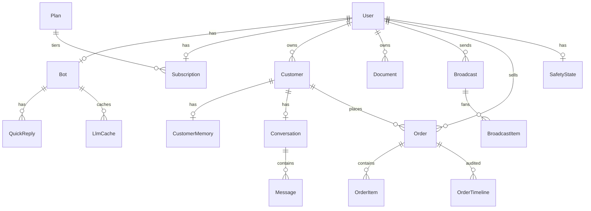

# Database Schema

Source of truth: `saas/prisma/schema.prisma` (565 lines).
DB engine: **SQLite** (`DATABASE_URL=file:./prod.db`).
Migration tool: `prisma db push` (additive only; never `migrate dev` in prod).

## Models (18 total)

### Tenancy / billing
- **`User`** — `id` (cuid), `email` unique, `passwordHash` (bcrypt), `name`, `phone`, `role` (`user|admin`).
- **`Plan`** — `slug`, `name`, `priceUsd`, `yearlyUsd`, `monthlyMsgs`, `features` (JSON), `popular`, `sortOrder`.
- **`Subscription`** — `userId@unique`, `planId`, `status` (`pending|active|expired|canceled`), `billingCycle`, `startedAt`, `expiresAt`, `msgsUsed`, `paymentRef`, `adminNote`.
- **`SiteConfig`** — singleton row (`id="singleton"`) with brand name, support contacts.

### Bot (the heart)
- **`Bot`** — one per user. **50+ fields.** Key groups:
  - Identity: `name`, `persona`, `systemPrompt`, `welcomeMessage`
  - WhatsApp link: `whatsappStatus`, `whatsappPhone`, `notifyPhone`, `connectionMode` (`unofficial|official`)
  - Working hours: `workingHoursEnabled`, `workingHours` (JSON), `outOfHoursMessage`, **`timezone`** (IANA, default `Africa/Cairo`)
  - Order detection: `orderKeywords` (CSV)
  - Humanize (Wave 5): `humanizeReplies`, `typingSpeedCps`, `preReplyDelayMs`, `dynamicEmojis`, `replyVariations`
  - Sales (Wave 7): `negotiationEnabled`, `negotiationFloorPct`, `persuasionEnabled`
  - Cache (Wave 12): `cacheEnabled`, `cacheTtlHours`
  - Daily cap: `dailyMessageCap`, `dailyMsgsUsed`, `dailyMsgsResetAt`
  - AI provider: `aiProvider` (`keyone|openai|gemini|openrouter|claude|groq`), `aiApiKeyEnc` (AES-256-GCM), `aiModel`
  - Daily report: `dailyReportEnabled`, `dailyReportHour`, `dailyReportLastSentAt`
  - Alerts: `alertEnabled`, `followUpsEnabled`, `followUpHours`

### CRM / chat
- **`Customer`** — `userId+phone` unique. Has CRM fields (`leadScore`, `lastIntent`, `lastSentiment`, `tags`, `notes`), personalization (`preferences`, `purchaseProb`, `bestHourLocal`), cart (`cartItems`, `cartUpdatedAt`, `cartReminderSent`), and **trust** (`trustScore`, `engagementScore`, `inboundCount`, `outboundCount`, `firstInboundAt`, `blockedAt`, `reportedAt`).
- **`CustomerMemory`** — 1:1 with Customer. `summary` (rolling Arabic), `factsJson` (structured), `messageCount`, `pendingCount`.
- **`Conversation`** — 1:1 with Customer (via `customerId@unique`). `summary`, `botPaused` (manual takeover).
- **`Message`** — many per Conversation. `role` (`user|assistant|system|tool|admin`), `content`, `mediaType`, `mediaUrl`, `flagged` (order/payment keyword hit), `intent`, `sentiment`. Indexed on `(conversationId, createdAt)`.

### Knowledge / FAQ
- **`Document`** — knowledge base content per user. `title`, `content`, `source` (`manual|url|pdf|docx|suggestion`).
- **`QuickReply`** — per bot. `triggers` (JSON array of phrases), `reply`, `enabled`, `hits`.
- **`KnowledgeGap`** — questions the bot couldn't answer. `question`, `occurrences`, `resolved`.

### Broadcasts
- **`Broadcast`** — `userId`, `title`, `template`, `audience` (`all|hot|warm|tag:<x>`), `personalize`, `status` (`queued|sending|done|canceled`), counters.
- **`BroadcastItem`** — per recipient. `customerId`, `phone`, `name`, `status` (`pending|sent|failed|skipped`), `error`, `sentAt`. **Atomic claim:** `updateMany({where:{status:"pending"}}, {status:"sending"})`.

### Orders
- **`Order`** — `userId`, `customerId`, `conversationId?`, snapshot fields (`customerName`, `customerPhone`, `shippingAddress`), money (`subtotal`, `shipping`, `discount`, `total`, `currency`), lifecycle (`status`, `fulfillmentStatus`, `paymentMethod`), extraction quality (`aiConfidence`, `aiNotes`, `source`).
- **`OrderItem`** — `name`, `size`, `color`, `quantity`, `unitPrice`, `lineTotal`.
- **`OrderTimeline`** — `kind` (`created|status_changed|note|reminder_sent|payment|ai_extracted`), `payload`, `message`.

### Cache
- **`LlmCache`** — exact-match cache per bot. `qHash` (sha256 of normalized question), `question`, `response`, `hits`, `expiresAt`. Unique on `(botId, qHash)`.

### Observability
- **`MetricEvent`** — daily counter. `(userId, day, kind)` unique. `userId="*"` for global. Used by `lib/metrics.ts:bump()`. Example kinds: `llm_call`, `llm_fail`, `cache_hit`, `semantic_hit`, `quick_reply_hit`, `realism_active`, `anti_ban_cooldown`, `order_extracted`, `daily_cap_hit`, `sales_mode_*`, `sales_skipped`.
- **`ProviderUsage`** — daily per-provider usage. `(userId, day, provider, model)` unique. Tracks calls, failures, tokens, latency.
- **`ApiCall`** — per-request endpoint hits (rate-limit foundation).

### Safety
- **`SafetyState`** — one per user. Persistent counters: warmup stage, daily/hourly sends, rolling risk score, trust score, cooldown, kill switch, failure counts.
- **`SafetyEvent`** — append-only sliding 24h log. `kind` (`send|failure|cooldown|warmup_advance|kill|reply|block|report`).
- **`SafetyAudit`** — high-signal admin events. `level` (`info|warn|critical`), `category` (`anti_ban|warmup|kill_switch|auth|broadcast|notify|orders`), `title`, `detail`, `payload`.

## Relations diagram (simplified)

## Important indexes

| Table | Index | Why |
|---|---|---|
| `Customer` | `(userId, leadScore)` | hot/warm filtering for broadcasts |
| `Customer` | `(followUpAt)` | cron picks due follow-ups |
| `Message` | `(conversationId, createdAt)` | history fetch (last 30) |
| `BroadcastItem` | `(broadcastId, status)` | claim query |
| `Order` | `(userId, createdAt)` | dashboard ordering |
| `MetricEvent` | `(day, kind)` | global rollup |
| `SafetyEvent` | `(userId, kind, createdAt)` | 24h aggregations |
| `SafetyAudit` | `(level, createdAt)` | admin filter for critical |

## Migration constraints

- **Additive only.** Never rename or drop columns via `db push` — it will refuse with "destructive change."
- New nullable columns are safe.
- New non-null columns **must have a `@default`** so existing rows fill automatically.
- Example of a clean recent migration: `Bot.timezone String @default("Africa/Cairo")` (see `WORKING_HOURS.md`).

## Volume estimates (rule-of-thumb, May 2026)

- ~1k customers per active merchant
- ~26 messages / 24h per single merchant in the audit window — see `audits/production-audit-summary.md`
- DB size: 135-176 KB per merchant in the dev snapshot
- At 50 merchants: ~7-9 MB DB → still well within SQLite's comfort zone
- SQLite breaks comfort when **concurrent writers** exceed ~5/s with long-held transactions. See `SCALING_PLAN.md`.
