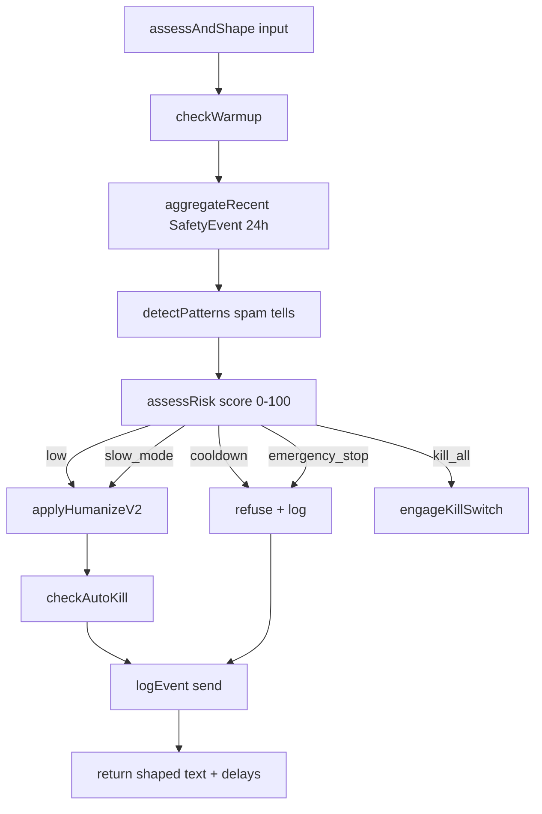

# Safety Engine v2

> Code: `saas/lib/safety/` (10 files)
> Entry: `assessAndShape(input)` in `saas/lib/safety/engine.ts`
> Persistent state: `SafetyState`, `SafetyEvent`, `SafetyAudit` (see `DATABASE_SCHEMA.md`)

## Purpose
Prevent the bot's WhatsApp account from getting **banned** by WhatsApp Inc.
Bans happen when a session looks bot-like: too many sends, sends to people
who never replied, all-identical replies, sudden activity bursts from a
brand-new number, etc.

This engine adds **persistent, per-merchant** counters + decisions that
survive Node restarts. It replaces the older in-memory `lib/anti-ban.ts`
(still in the repo; called for the priority hint only).

## Flow

## Warmup stages

Source: `saas/lib/safety/warmup.ts:20-27`.

| Stage | Age | maxDaily | maxHourly | newChats/10min | replyOnly | description |
|---|---|---|---|---|---|---|
| day1   | 0-1d | 20  | 6  | 3  | ✅ | اليوم الأول — رد فقط |
| day2_3 | 1-3d | 40  | 10 | 5  | ✅ | رد فقط |
| day4_5 | 3-5d | 80  | 14 | 8  |   | بث محدود مسموح |
| day6_7 | 5-7d | 150 | 20 | 12 |   | تدرّج للسعة الكاملة |
| week2  | 7-14d | 300 | 35 | 20 |   | الأسبوع الثاني |
| mature | 14d+ | 600 | 50 | 25 |   | حدود كاملة |

A high-trust bot (`trustScore >= 70` and no kill switch) gets a +0.5-day boost
when computing the target stage (`computeTargetStage`).

## Risk levels

Source: `saas/lib/safety/risk.ts`.

| Level | Effect |
|---|---|
| `low` | Send normally |
| `elevated` | Send, but slightly increased delays |
| `slow_mode` | +200% delays |
| `cooldown` | Refuse outbound for N minutes (returned to caller as `blocked` + `cooldownMs`) |
| `emergency_stop` | Hard block + audit |
| `kill_all` | Engage kill switch via `engageKillSwitch(userId, trigger)` |

Risk score (0-100) is the rolling counter on `SafetyState.riskScore`. It decays
over time and is bumped by pattern hits, send failures, reconnect storms,
high inbound:outbound ratio, etc.

## Pattern detection

Source: `saas/lib/safety/patterns.ts`. Detects spam-bot tells:
- Identical reply hashes within a short window
- All-uppercase / all-lowercase outbound
- High emoji density
- Sub-second response times (too fast to be human)
- Sending to a brand-new contact who never said hi

Each pattern carries a weight. The sum feeds into `assessRisk`.

## Kill switch

Source: `saas/lib/safety/kill-switch.ts`.

**Triggers:**
- Sustained mass send failures
- Reconnect storms
- Risk score ≥ 95 (`assessRisk` returns `shouldKill=true`)
- Mass blocks reported by `whatsapp-service`
- External admin call to `/api/safety/kill` (manual)

**Effect:**
- `SafetyState.killSwitchActive = true`
- `cooldownUntil = now + 24h`
- `SafetyAudit (level="critical", category="kill_switch")` row
- **All** outbound is refused until an admin clears it via `/api/safety/clear`.

## Contact trust (per customer)

Source: `saas/lib/safety/trust.ts`. Each `Customer` carries:
- `trustScore` (0-100, default 50)
- `engagementScore`
- `inboundCount` / `outboundCount`
- `firstInboundAt` (null = bot wrote first → cold; lower trust)
- `blockedAt`, `reportedAt`

`onInbound(customerId)` is called from the incoming hot path (line 147 of `incoming/route.ts`). It accrues trust and never blocks the reply.

## Humanize v2 (final shaping)

Source: `saas/lib/safety/humanize-v2.ts`. Applied after the LLM reply but
before returning to `wa-service`. It can:
- Vary punctuation
- Add micro-pauses
- Adjust typing delay based on `inboundLen` + `riskScore` + `vipShortcut`

Output: `{ text, preDelayMs, typingDelayMs }`. `whatsapp-service` honors
these delays before showing the "typing…" indicator and finally sending.

## Read trail — order of files to study

1. `engine.ts` — start here, it's the entry point
2. `store.ts` — DB shape, hashing, recent aggregation
3. `warmup.ts` — stage table
4. `risk.ts` — scoring logic
5. `patterns.ts` — spam-bot tells
6. `trust.ts` — per-contact trust
7. `humanize-v2.ts` — output shaping
8. `kill-switch.ts` — emergency stop
9. `queue.ts` — broadcast safety gates (not on hot path)
10. `broadcast.ts` — broadcast-specific risk

## Hard rules

- **DO NOT** raise warmup caps without auditing real WhatsApp metrics.
- **DO NOT** remove the kill switch trigger conditions.
- **DO NOT** make `assessAndShape` synchronous to the LLM call — it must run
  AFTER the LLM reply so the engine can hash the actual outbound body.
- **DO NOT** add an LLM call inside any safety module. Everything here is
  hot-path-friendly because it's pure logic.
- The audit table (`SafetyAudit`) is the merchant's debugging surface.
  **Every blocked send must produce an audit row** so the admin dashboard
  can show "why."
