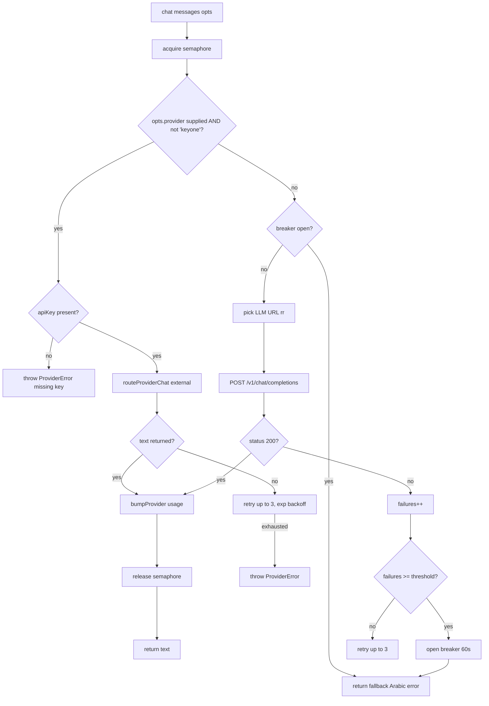

# Flow: AI Reply Generation

**Entry:** `chat(messages, opts)` in `saas/lib/llm.ts`
**Callers:** `incoming/route.ts` (hot path), broadcast personalize, follow-ups cron, suggest-reply, knowledge importer

## Decision tree



## Provider routing detail

**`opts.provider`** is computed by `botProviderOverride(bot)`:
```ts
// in lib/providers/bot-provider.ts
export function botProviderOverride(bot) {
  if (!bot.aiProvider || bot.aiProvider === "keyone") return undefined;
  if (!bot.aiApiKeyEnc) return undefined;  // misconfigured → fall back
  return {
    provider: bot.aiProvider,
    apiKey:   decrypt(bot.aiApiKeyEnc),   // AES-256-GCM
    model:    bot.aiModel,
  };
}
```

If `provider` is undefined → uses the in-house `keyone` path (mse-llm Python service).
If `provider.provider === "keyone"` → router refuses (explicit guard) and the caller must use the legacy path. Currently the router never receives `keyone` because `botProviderOverride` returns `undefined` for keyone.

## External provider call (`provider-router.ts:routeProviderChat`)

1. Validate `apiKey`
2. Loop up to `retries+1` times (default 3 attempts)
3. Dispatch to the right adapter:
   - `openai` → `callOpenAI(messages, opts)` — POST to `api.openai.com/v1/chat/completions`
   - `gemini` → `callGemini` — POST to `generativelanguage.googleapis.com`
   - `claude` → `callClaude` — POST to `api.anthropic.com`
   - `groq` → `callGroq` — POST to `api.groq.com/openai/v1`
   - `openrouter` → `callOpenRouter` — POST to `openrouter.ai/api/v1`
4. On error: classify as retryable or not (`isAbortOrNetwork(e)` + `e.retryable`)
5. Retryable → sleep `500ms × 2^attempt + random(0-400ms)` then retry
6. Terminal → throw `ProviderError`

## Concurrency limiter

`lib/llm.ts:50` — semaphore of `LLM_MAX_CONCURRENT` (default 3):
```ts
const waiters: Array<() => void> = [];
async function acquire() {
  if (active < MAX_CONCURRENT_LLM) { active++; return; }
  await new Promise(resolve => waiters.push(resolve));
  active++;
}
```

**Why this matters:** the in-house `mse-llm` runs a single Playwright Chromium. Parallel requests would queue inside Chromium and timeout. The semaphore enforces backpressure at the SaaS layer.

For external providers, the limit is less critical (vendor handles concurrency), but kept for cost/quota safety.

## Round-robin (keyone only)

`LLM_API_URLS=url1,url2,url3` → `rrIdx` rotates. Each call returns the
full list starting from `rrIdx`. Failed URLs are tried first; remaining
URLs serve as fallback.

If `LLM_API_URLS` is unset, falls back to `LLM_API_URL` (single URL).

## Circuit breaker (keyone only)

When consecutive failures cross a threshold:
1. Breaker opens
2. For the next 60s, all keyone calls short-circuit to the fallback string immediately
3. After 60s, one probe request is allowed; if it succeeds, breaker closes; if not, opens for another 60s

This prevents a dead `mse-llm` from holding up the request path for 30s × 3 retries per message.

## Metering

Every successful call increments:
- `MetricEvent`: `bump("llm_call", userId)`
- `ProviderUsage`: `bumpProvider(userId, provider, model, {inputTokens, outputTokens, latencyMs})`

Every failure increments `bump("llm_fail", userId)` and `ProviderUsage.failures`.

Visible at `/admin/metrics` and used as the basis for future billing.

## Token usage caveats

- OpenAI returns exact token counts in response → 100% accurate
- Gemini sometimes omits usage → counts default to 0
- Claude returns counts → accurate
- Groq returns counts → accurate
- OpenRouter forwards underlying counts → varies by model
- `keyone` (Playwright scraper) → no usage info; counts are 0

Aggregate billing should NOT rely solely on `ProviderUsage.totalTokens`
because of these gaps. Use `calls` as a rough proxy when tokens are 0.

## Fallback string

When the LLM path fails completely (timeouts, breaker open, provider err):
> `"عذراً، يبدو أن هناك خلل تقني مؤقت. سأعود لك خلال لحظات."`

This string is NEVER cached (the cache layer checks for this prefix).
