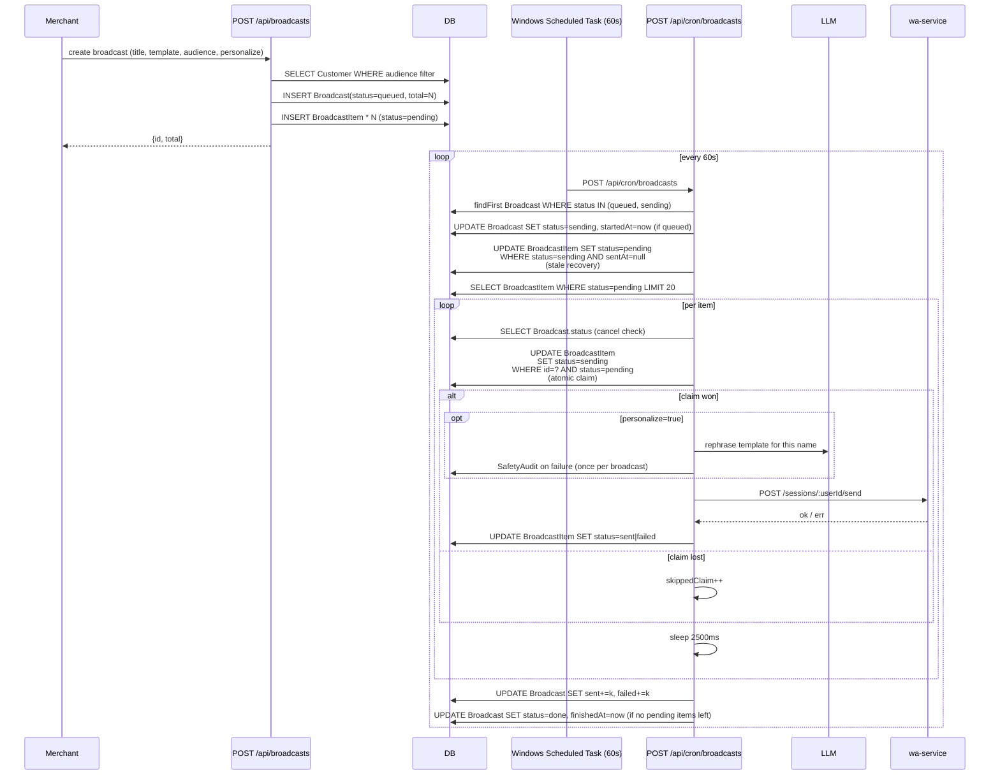

# Flow: Broadcast Send

**Files:**
- API (create): `saas/app/api/broadcasts/route.ts`
- Cron worker: `saas/app/api/cron/broadcasts/route.ts`
- DB: `Broadcast`, `BroadcastItem`

## Lifecycle



## Code map

### Create endpoint (`/api/broadcasts`)
1. Validates input (title, template, audience filter)
2. Resolves audience to customer list:
   - `all` → all Customer for this userId
   - `hot` → leadScore ≥ 70
   - `warm` → leadScore ≥ 40
   - `tag:<x>` → tags JSON contains x
3. Creates `Broadcast` row with `status="queued"`, `total=N`
4. Bulk inserts `BroadcastItem` rows with `status="pending"`

### Cron worker (`/api/cron/broadcasts`)
**Pick the broadcast (lines 27-39):**
```ts
const bc = await prisma.broadcast.findFirst({
  where: { status: { in: ["queued","sending"] } },
  orderBy: { createdAt: "asc" },
});
```

**Flip queued → sending (lines 34-39):**
First tick to encounter a `queued` broadcast claims it.

**Stale recovery (lines 41-57):**
Releases items stuck in `sending` from a previous crashed tick.

**Atomic claim (lines 104-112):**
```ts
const claim = await prisma.broadcastItem.updateMany({
  where: { id: it.id, status: "pending" },
  data:  { status: "sending" },
});
if (claim.count === 0) { skippedClaim++; continue; }
```

**Personalize (lines 117-172):**
- LLM call with prompt: "خصّص رسالة تسويقية"
- Result replaces template body
- Failures audited once per broadcast

**Send (lines 174-189):**
- `wa.send(bc.userId, it.phone, body)`
- On OK: update item to `sent`, `sentAt=now`
- On error: update item to `failed`, store error string

**Pause (line 190):**
- `sleep(SEND_DELAY_MS=2500)` between sends

## Throughput

- 20 items/tick × 60 ticks/hour = **1200 sends/hour per merchant**
- Real-world ~750/hour (LLM personalize adds latency)
- Multiple merchants run in parallel (different ticks pick different `bc.userId`)

## Audience materialization timing

**Audience is captured at CREATE time.** `BroadcastItem` rows are inserted with the customer phone + name at that moment. Changing `Customer` after broadcast creation does NOT change the audience.

This is intentional: prevents a `hot` broadcast from sending to customers who *became* hot mid-broadcast.

## Failure scenarios

| Scenario | What happens |
|---|---|
| LLM personalize fails | First failure → SafetyAudit row. Template body used. |
| WA send fails | Item → failed, error string saved (200 chars). |
| WA service down | All items in tick fail. Next tick retries unclaimed items. |
| Cron task disabled | Broadcasts stuck in `queued`. Re-enable, items proceed. |
| Broadcast canceled mid-tick | Tick detects cancel at top of each iteration, exits cleanly. |
| Server restart mid-tick | Items in `sending` are released by next tick's stale recovery. |
| Concurrent ticks | Atomic claim ensures one wins; loser `skippedClaim++`. |

## Anti-ban interaction

The broadcast worker does NOT call `lib/safety/engine.ts:assessAndShape` per
item. The safety engine is on the **reply** path, not the broadcast path.
For broadcasts, safety is provided by:
1. Throttling (2.5s between sends)
2. Volume cap (20 sends/tick × 1 broadcast/merchant at a time)
3. Warmup limits via `lib/safety/broadcast.ts` (**uncertain whether wired** — see `KNOWN_ISSUES.md` P2)
4. Per-merchant `Bot.dailyMessageCap` — but this is currently checked only on the incoming hot path, NOT broadcasts.

**Risk:** a merchant in `warmup.stage="day1"` could blast a 1000-recipient
broadcast and violate WhatsApp's daily limit. Track in `KNOWN_ISSUES.md`.
