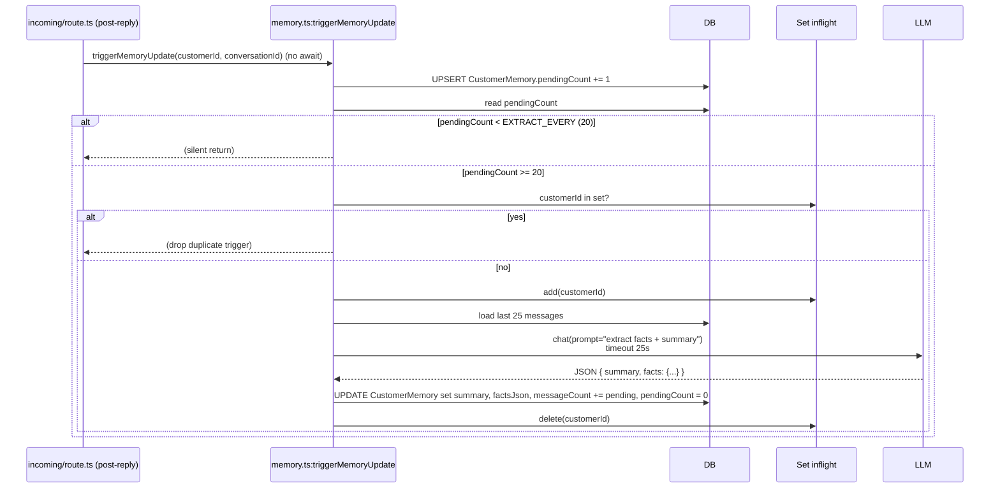

# Flow: Memory Engine

**Files:** `saas/lib/memory.ts` (371 lines)
**Storage:** `CustomerMemory` (1:1 with Customer)
**Trigger:** every inbound user message (fire-and-forget)
**LLM extraction:** every `MEMORY_EXTRACT_EVERY` (default 20) messages

## Sequence



## Why background?

Synchronous extraction would add 1-3 seconds to the reply on every 20th
message. Customers would notice. Fire-and-forget means: the bot replies
fast, and the memory updates "soon."

## In-flight deduplication

```ts
const inflight = new Set<string>();
```

Process-local. If the same `customerId` is already mid-extraction, drop
the new trigger. Resets on Node restart — fine, the next trigger
re-runs the extraction.

## What gets stored

```ts
// CustomerMemory.factsJson — JSON-parsed shape
type MemoryFacts = {
  products?: string[];      // ["تيشيرت قطن", "بنطلون جينز"]
  sizes?: string[];         // ["L", "32"]
  colors?: string[];        // ["أسود", "أزرق"]
  budget?: number;          // 500 (EGP)
  frequency?: string;       // "first-time" | "occasional" | "frequent"
  tone?: string;            // "calm" | "warm" | "impatient" | "skeptical"
  objections?: string[];    // ["price", "shipping"]
  negotiation?: { rounds, lastFloor, state } | string;  // from sales engine
  lastTopics?: string[];    // recent themes
};

// CustomerMemory.summary — short Arabic rolling summary, ~200-500 chars
```

## How it's injected into the prompt

`incoming/route.ts:323-327`:
```ts
const [knowledgeBase, memorySnap] = await Promise.all([
  retrieveRelevantKb(...),
  loadMemory(customer.id),
]);
const memoryBlock = buildMemoryBlock(memorySnap);
```

`buildMemoryBlock(snap)` produces Arabic text like:
```
## ما نعرفه عن العميل
- ملخص الحوار: <summary>
- منتجات اهتمّ بها: تيشيرت قطن, بنطلون جينز
- الميزانية: 500 جنيه
- الاعتراضات: السعر, الشحن
- نبرة العميل: calm
```

This block is prepended to the system prompt.

## Token-cost win

When `summary` exists, `buildMessages` truncates history from 20 → 8 messages.
Combined with the cached summary, prompt size drops significantly on long
conversations.

**Net cost:** 1 extra LLM call per 20 inbound msgs ≈ 5% overhead. **Net
savings:** shorter prompts on every subsequent call → typically 30-50%
fewer tokens. **Win.**

## Negotiation state piggybacks

The sales engine writes `factsJson.negotiation` via `persistNegotiationState`:
```ts
facts.negotiation = applySignalsToNegotiation(prev, signals);
```

This is a separate write path from the LLM extractor but lives in the
same `factsJson` column. Both write paths merge into the existing facts
instead of overwriting.

## Failure modes

| Failure | Effect |
|---|---|
| LLM timeout (25s) | Extractor exits, `inflight` cleared, next trigger retries |
| LLM returns invalid JSON | Extractor logs warning, skips update |
| DB error on UPDATE | Logged, extractor exits silently |
| `loadMemory` fails | Returns `EMPTY = {summary:"", facts:{}, hasSummary:false}` |

## Manual ops

Inspect a customer's memory:
```sql
SELECT summary, factsJson, messageCount, pendingCount, updatedAt
FROM CustomerMemory WHERE customerId = '<id>';
```

Force re-extraction (clear `pendingCount`):
```sql
UPDATE CustomerMemory SET pendingCount = 100 WHERE customerId = '<id>';
-- next inbound triggers extraction immediately
```

Clear memory entirely (rarely needed):
```sql
UPDATE CustomerMemory
SET summary = '', factsJson = '{}', pendingCount = 0, messageCount = 0
WHERE customerId = '<id>';
```

## Don't

- Don't lower `MEMORY_EXTRACT_EVERY` below 5 — LLM cost spikes
- Don't make the trigger synchronous
- Don't store PII outside `factsJson` — there's a single audit surface
- Don't add a new field to `MemoryFacts` without updating the LLM extractor prompt to surface it
