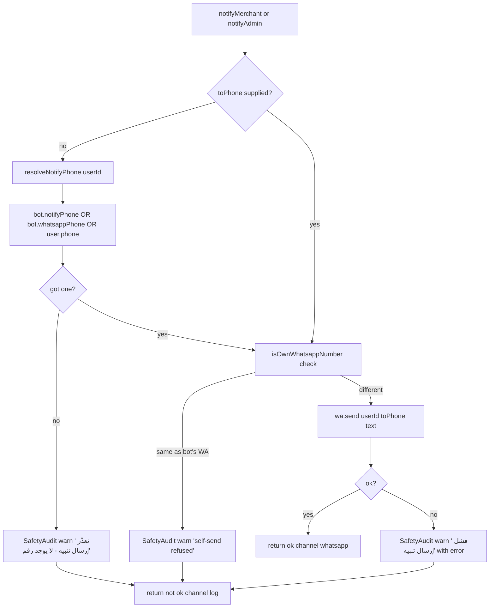

# Flow: Notification (Merchant Alerts)

**Files:** `saas/lib/notify.ts` (166 lines).
**Callers:** order alert (`incoming/route.ts:476`), anger alert (`classifyAndScore` line 733), various.

## Decision tree



## Phone resolution chain

`resolveNotifyPhone(userId)`:
```ts
const u = await prisma.user.findUnique({
  where: { id: userId },
  select: { phone: true, bot: { select: { notifyPhone: true, whatsappPhone: true } } },
});
return u.bot?.notifyPhone || u.bot?.whatsappPhone || u.phone || null;
```

Priority:
1. **`Bot.notifyPhone`** — explicitly set by merchant for alerts
2. **`Bot.whatsappPhone`** — number connected as the bot
3. **`User.phone`** — account signup phone

If all empty → return null → caller writes "no phone" audit row.

## Self-send guard

`isOwnWhatsappNumber(userId, phone)`:
```ts
const bot = await prisma.bot.findUnique({ where: {userId}, select: {whatsappPhone:true} });
if (!bot.whatsappPhone || !phone) return false;
const a = bot.whatsappPhone.replace(/\D/g, "");
const b = phone.replace(/\D/g, "");
return a.slice(-9) === b.slice(-9);  // last 9 digits (handles country code variance)
```

If true → refuse send, write audit row with explanation:
> "رقم تنبيه الطلبات هو نفس رقم الواتساب المتصل بالبوت. واتساب لا يسمح بإرسال رسالة لنفس الرقم."

## Two callable functions

### `notifyMerchant({userId, toPhone, fromCustomer, text})`
Used for **order alerts**. Prepends a fixed header:
```
🔔 *تنبيه طلب جديد*
العميل: <name>
الرقم: <phone>
الرسالة: <text 500-char>
```

### `notifyAdmin({userId, toPhone, text, category?})`
Generic. Used for:
- **Anger alerts** (`category="anger"`) — text already includes the `🚨` header
- **Broadcast failures** (`category="broadcast"`)
- **Follow-up failures**

## Audit row shape

Every failure writes:
```ts
await prisma.safetyAudit.create({
  data: {
    userId,
    level: "warn",            // or "critical" in extreme cases
    category: "notify",       // single shared category
    title:  "<short Arabic title>",
    detail: "<reason or upstream error, max 400 chars>",
    payload: JSON.stringify({ toPhone, kind: category || "admin" }),
  },
});
```

## Where audits surface

- `/admin/safety` page (filter by category `notify` for alert failures)
- Direct DB query: `SELECT * FROM SafetyAudit WHERE category='notify' ORDER BY createdAt DESC LIMIT 20`

## Fire-and-forget contract

All callers wrap in `.catch(() => {})`:
```ts
notifyMerchant({...}).catch(() => {});
```

If `notify.ts` itself throws (unlikely — it has its own try/catch internally), the calling request still proceeds normally. The customer reply is never blocked.

## What NOT to do

- **Don't log alert text bodies to console.** They may contain PII.
- **Don't add new alert types without specifying `category`.** Makes audit filtering useless.
- **Don't bypass the self-send guard.** Merchants WILL configure their own number by mistake; the guard saves them from confusing failures.
- **Don't await `notifyMerchant` on the hot path.** Background only.
