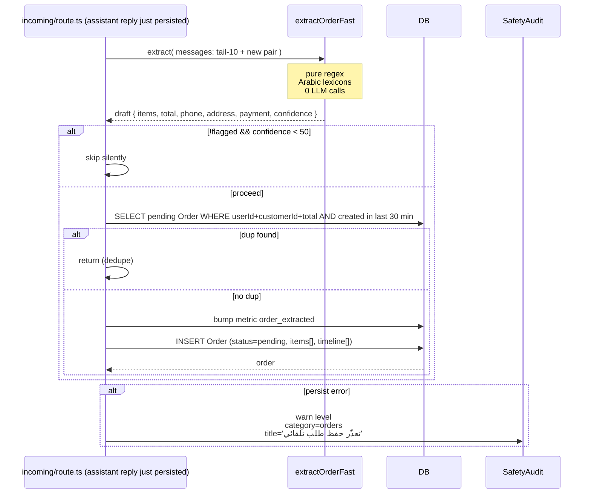

# Flow: Order Extraction

**Entry:** `extractAndStoreOrder({...})` in `saas/app/api/whatsapp/incoming/route.ts:751`
**Engine:** `extractOrderFast({...})` in `saas/lib/order-extractor.ts`
**DB:** `Order`, `OrderItem`, `OrderTimeline`

## Sequence



## When does extraction run?

`incoming/route.ts:485-506`:

```ts
const orderHistory = [
  ...conv.messages.slice(-10).map(m => ({role: m.role, content: m.content})),
  { role: "user", content: messageText },
  { role: "assistant", content: reply },
];
extractAndStoreOrder({
  userId, customerId: customer.id, conversationId: conv.id,
  customerName: customer.name,
  customerPhone: customer.phone,
  historyTail: orderHistory,
  flagged,  // true if message hit Bot.orderKeywords
}).catch(...);
```

**Runs after EVERY assistant reply.** Background (`.catch`). Never blocks customer reply.

## Two thresholds

```ts
if (!args.flagged && draft.confidence < 50) return;  // strict for implicit
// flagged messages bypass the 50 threshold (looser for payment-keyword flows)
```

Why:
- **Flagged** = customer literally said `"اوردر"` or `"حولت 350"`. Even with weak metadata, it's likely a real intent.
- **Unflagged** = implicit (`"تمام عاوز"` after price discussion). Need stronger signal to avoid false positives.

## Dedupe (30 min sliding window)

```ts
const cutoff = new Date(Date.now() - 30 * 60_000);
const dup = await prisma.order.findFirst({
  where: {
    userId, customerId,
    status: "pending", total: draft.total,
    createdAt: { gte: cutoff },
  },
});
if (dup) return;
```

Prevents the same chat from creating multiple identical pending orders as
the customer keeps elaborating.

## What gets extracted (in `lib/order-extractor.ts`)

### Items
- **Quantity** — `detectQuantity()` reads Arabic + Western digits, also "اتنين/تلاته/اربعه"
- **Size** — looks for `مقاس|سايز|مقاسه|مقاسي|حجم` followed by value
- **Color** — matches 13 colors × 3-4 spellings each
- **Name** — best-effort: product noun phrase preceding the number/price

### Customer
- **`customerName`** — `extractName(text)` (heuristic: first proper noun after `أنا/اسمي`)
- **`customerPhone`** — `extractPhone(text)` (E.164 + Egyptian formats)
- **`shippingAddress`** — looks for `العنوان|شارع|عماره|محافظه|...`

### Money
- **`paymentMethod`** — `cod | instapay | vodafone_cash | card | bank_transfer`
- **`subtotal`, `shipping`, `discount`, `total`** — pattern match on `EGP|جنيه|ريال|...` near digits
- **`currency`** — default `EGP`

### Confidence (0-100)
Sum of partial credits per field detected. Typical scores:
- Product name + price + quantity → 70-90
- Just product name → 30-40
- Just price + no product → 25
- Full address + payment method + items → 90+

## Persistence

Single Prisma `Order.create` call with nested `OrderItem` and `OrderTimeline`:

```ts
prisma.order.create({
  data: {
    userId, customerId, conversationId,
    customerName, customerPhone, shippingAddress,
    subtotal, shipping, discount, total, currency,
    paymentMethod, status: "pending", fulfillmentStatus: "unfulfilled",
    aiConfidence, aiNotes, source: "auto",
    items: { create: [...] },
    timeline: {
      create: [
        { kind: "created",      message: "تم إنشاء الطلب تلقائياً من المحادثة." },
        { kind: "ai_extracted", message: notes, payload: JSON.stringify({confidence}) },
      ],
    },
  },
});
```

## Merchant review

Orders land at `/dashboard/orders` filtered by status. Suggested filters:
- **`pending` + `aiConfidence >= 70`** → high-confidence auto-extractions to confirm
- **`pending` + `aiConfidence < 50`** → review for false positives
- **`pending` + `flagged_reason IS NOT NULL`** → merchant-flagged

## Failure handling

If `prisma.order.create` throws:
1. Log to console
2. `SafetyAudit (level="warn", category="orders")` row with the error detail + customer info
3. Swallow (don't block customer reply)

Merchant sees the failure in `/admin/safety` filter by `category=orders`.

## Common false positives (be aware)

- "ابعتلي صورة" → mentions "ابعتلي" which is in ADDRESS_HINTS lexicon
- A number that's NOT a price (phone, address number) gets picked up as `total`
- Customer joking about prices ("أكيد بمليون!") with valid-looking digits

**Mitigation:** the confidence score keeps most of these out via the 50-threshold. The merchant manually reviews `pending` orders before fulfilling.
