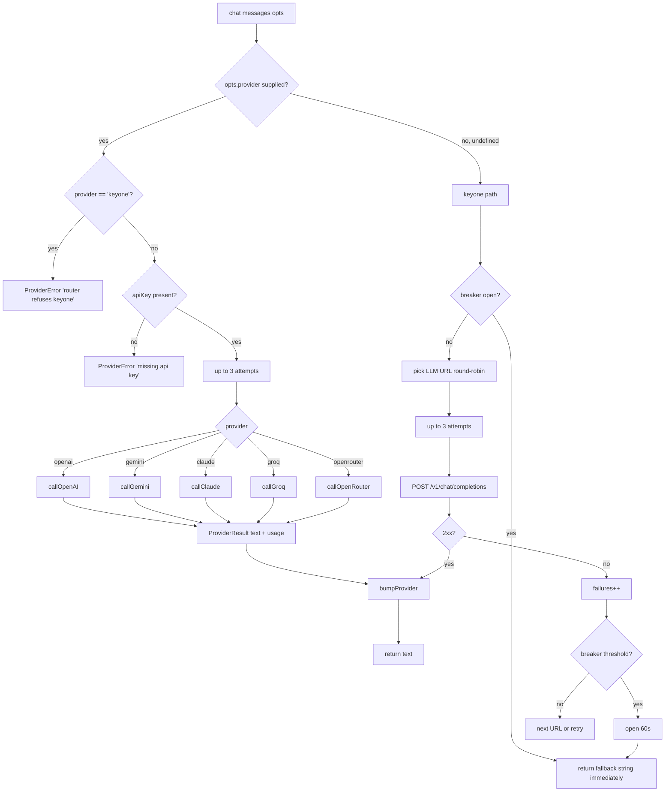

# Flow: AI Provider Routing

**Files:**
- `saas/lib/llm.ts` — main entry (`chat()`)
- `saas/lib/providers/provider-router.ts` — external routing
- `saas/lib/providers/bot-provider.ts` — per-bot override resolution
- `saas/lib/providers/{openai,gemini,claude,groq,openrouter}.ts` — adapters
- `saas/lib/crypto-util.ts` — AES-256-GCM for API keys

## How a single LLM call is routed



## `botProviderOverride(bot)` resolution

```ts
// in lib/providers/bot-provider.ts
export function botProviderOverride(bot: Bot): ProviderOverride | undefined {
  if (!bot.aiProvider || bot.aiProvider === "keyone") return undefined;
  if (!bot.aiApiKeyEnc) return undefined;  // misconfigured → fall back to keyone
  return {
    provider: bot.aiProvider as ProviderId,
    apiKey: decrypt(bot.aiApiKeyEnc),
    model: bot.aiModel,
  };
}
```

- `Bot.aiProvider = "keyone"` (default) → returns `undefined` → `chat()` uses internal path
- `Bot.aiProvider = "openai"` + valid `aiApiKeyEnc` → returns override → `chat()` calls `routeProviderChat`
- `Bot.aiProvider = "openai"` + missing `aiApiKeyEnc` → returns `undefined` → silent fallback to keyone path. **No error surfaced to the merchant.** Consider adding a setup-incomplete check.

## External adapters

Each provider has a thin adapter. All share the `ProviderResult` shape:
```ts
type ProviderResult = {
  text: string;
  usage?: { inputTokens: number; outputTokens: number; latencyMs: number };
};
```

### `callOpenAI` (`lib/providers/openai.ts`)
- POST `https://api.openai.com/v1/chat/completions`
- Headers: `Authorization: Bearer <key>`
- Body: `{ model, messages, temperature, max_tokens }`
- Default model: `gpt-4o-mini` (overrideable via `opts.model` or `Bot.aiModel`)

### `callGemini` (`lib/providers/gemini.ts`)
- POST `https://generativelanguage.googleapis.com/v1beta/models/<model>:generateContent?key=<key>`
- Body: Gemini-shape (contents array with `role: "user"|"model"`)
- Adapter normalizes messages → contents and back

### `callClaude` (`lib/providers/claude.ts`)
- POST `https://api.anthropic.com/v1/messages`
- Header: `x-api-key: <key>`, `anthropic-version: 2023-06-01`
- Body: `{ model, messages, max_tokens, system }` — Claude wants `system` separate

### `callGroq` (`lib/providers/groq.ts`)
- POST `https://api.groq.com/openai/v1/chat/completions`
- OpenAI-compatible body
- Default model: `llama-3.x-...`

### `callOpenRouter` (`lib/providers/openrouter.ts`)
- POST `https://openrouter.ai/api/v1/chat/completions`
- OpenAI-compatible body
- Default model: `meta-llama/llama-3.1-8b-instruct:free` or user-chosen
- Headers include `HTTP-Referer` for OpenRouter analytics

## Retry policy (router)

```ts
const retries = opts.retries ?? 2;  // up to 3 attempts total
for (let attempt = 0; attempt <= retries; attempt++) {
  try { return await dispatch(...); }
  catch (e) {
    const retryable = e instanceof ProviderError ? e.retryable : isAbortOrNetwork(e);
    if (!retryable || attempt === retries) throw e;
    await sleep(500 * Math.pow(2, attempt) + Math.random() * 400);
  }
}
```

Retryable:
- Network errors (ECONNRESET, ETIMEDOUT, ENOTFOUND, "fetch failed")
- HTTP 5xx
- AbortError (timeout)

Non-retryable (terminal):
- HTTP 4xx (401 unauthorized, 400 bad request, 429 rate limit)
- Adapter parse errors

## Test endpoint

`POST /api/settings/ai-provider/test`:
```ts
testProviderKey(provider, apiKey, model);
// → { ok: true, preview, usage } or { ok: false, error, status }
```

Used by the dashboard to validate keys before saving.

## Metrics writes

Every successful call: `bumpProvider(userId, provider, model, {inputTokens, outputTokens, latencyMs})` upserts `ProviderUsage`.

Every failure: `bump("llm_fail", userId)` + `ProviderUsage.failures += 1`.

## Common provider quirks (tribal knowledge)

- **OpenAI** — most reliable. `gpt-4o-mini` is the recommended default for cost/quality.
- **Gemini** — usage data sometimes missing → `inputTokens=0, outputTokens=0`. Don't bill on it directly.
- **Claude** — separates `system` from `messages`. Adapter does this; don't bypass.
- **Groq** — extremely fast but limited model selection.
- **OpenRouter** — variable latency depending on backing provider. Good for testing free models.

## How a merchant switches providers

1. `/dashboard/settings/ai-provider`
2. Enter API key (UI encrypts client-side? Verify — currently the key is POSTed to `/api/settings/ai-provider/save` and encrypted server-side with `crypto-util.encrypt`)
3. Hit "اختبار الاتصال" — calls `testProviderKey`
4. On 200 → save → `Bot.aiProvider`, `Bot.aiApiKeyEnc`, `Bot.aiModel` updated
5. Next customer message uses new provider. Behavior layers unchanged.

## What is NOT affected by provider choice

- Realism, anti-ban, safety engine
- Memory engine, sales engine
- Quick replies, semantic FAQ
- Cache (LlmCache works the same)
- Knowledge retrieval
- Order extraction

Only the **text generation source** changes. Designed this way to prevent
provider switching from regressing bot quality.
