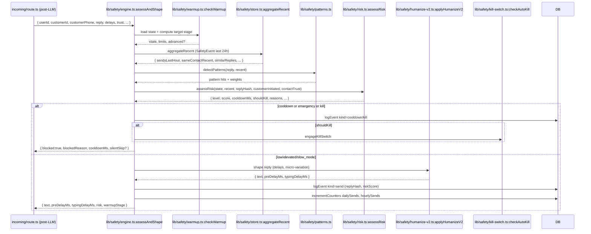

# Flow: Safety Engine

**Files:** `saas/lib/safety/*.ts`
**Entry:** `assessAndShape(input)` in `engine.ts`
**Persistent state:** `SafetyState`, `SafetyEvent`, `SafetyAudit`

## Sequence (per outbound reply)



## Input contract

```ts
interface AssessInput {
  userId: string;
  customerId?: string | null;
  customerPhone: string;
  reply: string;
  basePreDelayMs: number;
  baseTypingDelayMs: number;
  customerInitiated: boolean;     // false = bot wrote first (cold; high risk)
  contactTrust: number;           // 0-100 from Customer.trustScore
  inboundCount1H?: number;        // optional, used for imbalance check
  customerLocalHour?: number;     // optional, time-of-day risk
  workingHours?: { from, to } | null;
  vipShortcut?: boolean;          // bypass some delays for hot leads
  inboundLen?: number;            // for response-length variability
}
```

## Output

```ts
interface AssessOutput {
  text: string;
  preDelayMs: number;
  typingDelayMs: number;
  blocked: boolean;
  blockedReason?: string;
  cooldownMs: number;
  risk: "low" | "elevated" | "slow_mode" | "cooldown" | "emergency_stop" | "kill_all";
  riskScore: number;
  reasons: string[];
  warmupStage: string;
  silentSkip: boolean;
}
```

## Warmup stage detail

See `SAFETY_ENGINE.md` for the stage table. Key call:
```ts
const { state, limits, advanced } = await checkWarmup(userId);
```
If `advanced=true`, a stage transition just occurred (logged to SafetyAudit).

`computeTargetStage()` factors in:
- Age in days since `warmupStartedAt`
- Trust boost (`+0.5d` if `trustScore >= 70 && !killSwitchActive`)

## Risk scoring (`risk.ts:assessRisk`)

Inputs build a final `score` (0-100) starting from `state.riskScore` (the
decayed rolling score). Adjustments include:

| Signal | Weight |
|---|---|
| Pattern hits (from `patterns.ts`) | summed weights |
| Recent send burst (sendsLastHour > limits) | +large |
| Same contact spam (sameContactRecent > 3) | +medium |
| Identical reply hash within window | +large |
| Cold contact (`!customerInitiated`) | +small |
| Low contactTrust (<30) | +small |
| Sub-second response (too fast) | +small |
| Failures recently | +medium |
| Stage offset (mature gets headroom) | -offset |

Score → level mapping:
- < 25 → `low`
- 25-49 → `elevated`
- 50-69 → `slow_mode` (delayMultiplier ≈ 3x)
- 70-89 → `cooldown` (cooldownMs ≈ 5-30 min)
- 90-94 → `emergency_stop` (cooldownMs ≈ 2 hours)
- ≥ 95 → `kill_all` (`shouldKill=true`)

## Patterns (`patterns.ts:detectPatterns`)

Spam-bot tells:
- Identical reply to many contacts in a short window
- All caps / all lowercase / no punctuation
- High emoji density
- Repetitive phrasing across replies
- Sending to a contact who never replied

Each pattern carries an integer weight (5-20).

## Kill switch engagement

When `risk.shouldKill` is true OR external trigger:
```ts
await engageKillSwitch(userId, { reason, detail, payload });
```

Effect:
- `SafetyState.killSwitchActive = true`
- `cooldownUntil = now + 24h`
- `SafetyAudit (level=critical, category=kill_switch)` row
- All future `assessAndShape` calls short-circuit to `{ blocked: true, blockedReason: "kill_switch_active" }`

To clear: admin calls `clearKillSwitch(userId, byAdmin)` (resets counters too).

## Trust accrual (per-contact)

`onInbound(customerId)` (`lib/safety/trust.ts`) is fired from the incoming
hot path (line 147 of `incoming/route.ts`). Increments `Customer.trustScore`,
`engagementScore`, `inboundCount`, sets `firstInboundAt` if null.

## Persistent state

All counters live in `SafetyState`. Decay/reset rules:
- `dailySends` resets at UTC midnight (when worker sees `dailySendsResetAt < startOfToday`)
- `hourlySends` resets every hour
- `riskScore` decays linearly toward 0 (-X/min in the engine)
- `recentFailures`, `recentReconnects` reset every hour

Decay is **lazy** — only computed when a write happens. No background worker.

## Why this design

The safety engine is **the most sensitive** code in the project. Choices to note:
- All decisions are made AFTER the LLM call, never before — so the reply hash is real
- Pure logic (no LLM, no external HTTP) — runs in <30 ms
- Fail-open: any DB hiccup defaults to "low risk + small delay" instead of blocking. The bot must never go silent because of an internal error.
- Every blocked send writes an audit row → merchant can debug

## Hard rules

See `AI_AGENT_RULES.md` and `SAFETY_ENGINE.md`. Summary:
- Never raise warmup caps without auditing real metrics
- Never remove kill switch triggers
- Never add LLM calls inside the engine
- Audit every blocked send
