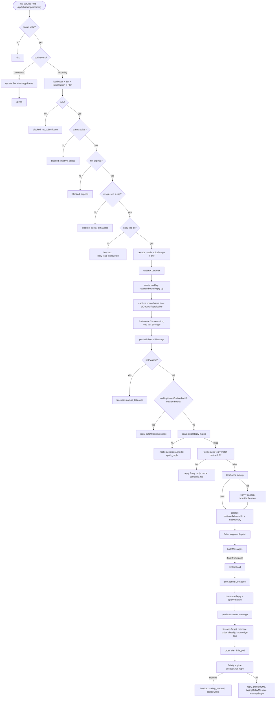

# Flow: WhatsApp Incoming Message

**Entry:** `POST /api/whatsapp/incoming`
**File:** `saas/app/api/whatsapp/incoming/route.ts` (874 lines, single `POST` handler)
**Caller:** `whatsapp-service` (every customer message)
**Auth:** `X-Internal-Secret` header

## Phase-by-phase

## Detail per phase

### 1. Auth + body parse (lines 40-50)
- `X-Internal-Secret` must match env `SAAS_INTERNAL_SECRET`
- Body must contain `event` and `userId`
- Events: `"connected"` (link status update) or `"incoming"` (customer message)

### 2. Tenant load (lines 74-84)
- Single Prisma query: `user.findUnique` with includes for `bot`, `bot.quickReplies (enabled)`, `subscription.plan`
- 1 round-trip
- ~20 ms typical

### 3. Subscription gates (lines 96-104)
- No subscription → 200 with `blocked: "no_subscription"`
- Inactive / expired → blocked accordingly
- Over monthly cap (`sub.msgsUsed >= sub.plan.monthlyMsgs`) → `quota_exhausted`

### 4. Daily cap (lines 109-123)
- Only when `Bot.dailyMessageCap > 0`
- Rolls counter when `dailyMsgsResetAt < utcStartOfToday`
- Returns `daily_cap_exhausted` if hit
- Bumps `daily_cap_hit` metric

### 5. Media decode (lines 126-132)
- Voice → `transcribeAudio(base64, mimetype)` via Whisper-compatible call (in `lib/media.ts`)
- Image → `describeImage(base64, mimetype, caption)` via vision LLM
- Resulting text replaces `messageText`

### 6. Customer upsert + trust (lines 138-150)
- `prisma.customer.upsert({ where: {userId_phone: ...} })` — atomic
- `onInbound` accrues trust (background)
- `recordInboundReply` logs to `SafetyEvent` (background)

### 7. LID phone capture (lines 152-198)
- If `customer.phone` starts with `lid:` or contains `@lid`, the customer was indexed via Linked Device ID (no real phone)
- Try to extract a real phone + name from the message body (`extractPhone`, `extractName`)
- Update the row IF the new phone isn't already owned by another customer
- Non-fatal on failure

### 8. Conversation + Message persist (lines 200-223)
- Find/create `Conversation`
- Load last 30 messages for history context
- Insert the inbound Message (immediately so live inbox sees it)

### 9. Manual takeover (lines 226-230)
- If `Conversation.botPaused`, classify in background but don't reply
- Returns `blocked: "manual_takeover"`

### 10. Out of office (lines 232-246)
- `inWorkingHours(bot.workingHours, new Date(), bot.timezone || "Africa/Cairo")`
- If outside, send `Bot.outOfHoursMessage` (still humanized)

### 11. Stage A — Exact quick reply (lines 248-267)
- `matchQuickReply(messageText, bot.quickReplies)` — substring/exact match
- 0 LLM cost
- On hit: bump `quick_reply_hit`, increment subscription usage, return

### 12. Stage B — Fuzzy quick reply (lines 269-292)
- `fuzzyMatchQuickReplies(messageText, bot.quickReplies, 0.62)` — cosine on trigger phrases
- 0 LLM cost
- On hit: bump `semantic_hit`, return

### 13. LlmCache lookup (lines 294-316)
- `getCached(botId, cacheEnabled, messageText)` — sha256 key match
- Only triggers when not first message + text only
- On hit: skip prompt assembly entirely

### 14. KB retrieval + memory (lines 318-327)
- `Promise.all([retrieveRelevantKb(...), loadMemory(...)])`
- KB: top-4 chunks, 3500 char budget
- Memory: rolling summary + facts

### 15. Sales engine (lines 329-371)
- Gated on `persuasionEnabled` + `leadScore≥30` + intent
- Detects signals, picks mode, builds block (≤120 tokens)
- Bumps `sales_mode_<mode>` or `sales_skipped` metric

### 16. LLM call (lines 374-415)
- Only when `!fromCache`
- `llmChat(messages, {temperature, provider, meterUserId})`
- Provider: `botProviderOverride(bot)` (decrypts API key if external)
- On failure: friendly Arabic fallback string

### 17. Humanize + realism (lines 423-443)
- `humanizeReply(text, humanCfg, hints)` — emoji + variation
- `applyRealism(text, ctx)` — anti-repetition + natural imperfections

### 18. Persist + counters (lines 445-467)
- Insert assistant Message
- `triggerMemoryUpdate` (bg)
- Increment `Subscription.msgsUsed`, `Bot.dailyMsgsUsed`
- Bump `realism_active` if applicable

### 19. Order alert (lines 469-483)
- If `flagged=true`, send notification to merchant (bg)
- Phone: `notifyPhone || whatsappPhone`

### 20. Order extraction (lines 485-506)
- `extractAndStoreOrder` (bg) — regex pipeline, confidence ≥ 50

### 21. Classify + score + anger alert (lines 509-520)
- `classifyAndScore` (bg) — intent, sentiment, lead score, follow-up scheduling
- Anger alert via `notifyAdmin` if sentiment is angry/negative

### 22. Knowledge gap (lines 522-531)
- If reply looks like an "I don't know," `recordKnowledgeGap` (bg)

### 23. Safety engine (lines 538-573)
- `computePriority` from `lib/anti-ban.ts` (used as a hint)
- `assessAndShape` — the real gate
- Returns blocked or shaped reply

### 24. Response (lines 575-583)
- `{ ok: true, reply, preDelayMs, typingDelayMs, risk, riskScore, warmupStage }`
- `whatsapp-service` honors `preDelayMs` (read pause) + `typingDelayMs` (show typing) before sending

## Failure modes

| Failure | Effect |
|---|---|
| Prisma DB error | Caught at request level → 500. Customer sees no reply. |
| LLM timeout | Fallback Arabic string. Cache NOT updated. |
| Safety blocks | Reply is null; wa-service queues or drops. Audit row written. |
| Quick reply lookup error | Logged, falls through to LLM. |
| Knowledge cache cold | One-time 30-80 ms penalty; subsequent hot. |
