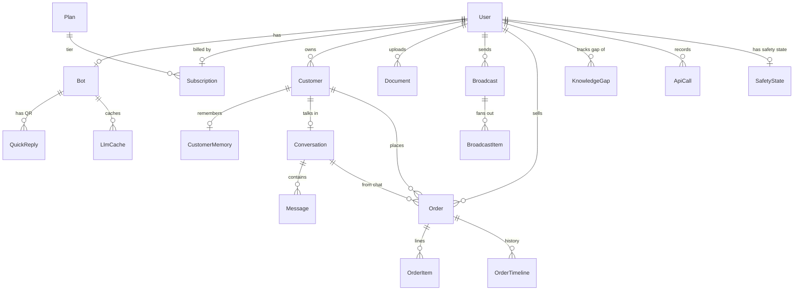

# Database Relations

Full schema: `saas/prisma/schema.prisma`. This file is a navigable visual.

## ER diagram



## Key relationships (with cascades)

| Parent | Child | onDelete |
|---|---|---|
| `User` | `Bot`, `Subscription`, `Customer`, `Document`, `Broadcast`, `Order`, `KnowledgeGap`, `ApiCall` | Cascade |
| `Bot` | `QuickReply`, `LlmCache` | Cascade |
| `Customer` | `CustomerMemory`, `Conversation`, `Order` | Cascade |
| `Conversation` | `Message`, `Order` (Order is SetNull) | Cascade |
| `Broadcast` | `BroadcastItem` | Cascade |
| `Order` | `OrderItem`, `OrderTimeline` | Cascade |
| `Plan` | `Subscription` | — (Restrict implicit; deleting a Plan with subs is unsafe) |

**Implication:** deleting a `User` row removes the entire merchant footprint
(customers, conversations, broadcasts, orders, subscriptions, ...). Use cautiously.

## Unique constraints worth knowing

| Constraint | Why |
|---|---|
| `User.email @unique` | One account per email |
| `Bot.userId @unique` | One bot per user |
| `Customer @@unique([userId, phone])` | Same phone can be a customer of multiple merchants |
| `Conversation.customerId @unique` | One conversation per customer |
| `CustomerMemory.customerId @unique` | One memory row per customer |
| `LlmCache @@unique([botId, qHash])` | Idempotent cache writes |
| `MetricEvent @@unique([userId, day, kind])` | Idempotent counter upserts |
| `ProviderUsage @@unique([userId, day, provider, model])` | Idempotent usage upserts |
| `Subscription.userId @unique` | One subscription per user |
| `Plan.slug @unique` | Stable plan reference |
| `SafetyState.userId @unique` | One state per bot |

## Indexes (performance-critical)

| Table | Index | Used by |
|---|---|---|
| `Customer` | `(userId, leadScore)` | Hot lead filtering for broadcasts |
| `Customer` | `(followUpAt)` | Follow-up cron pickup |
| `Message` | `(conversationId, createdAt)` | History fetch (last 30) |
| `BroadcastItem` | `(broadcastId, status)` | Atomic claim query |
| `Order` | `(userId, status)`, `(userId, createdAt)`, `(customerId)` | Dashboard queries |
| `MetricEvent` | `(day, kind)` | Global rollups |
| `SafetyEvent` | `(userId, createdAt)`, `(userId, kind, createdAt)` | 24h aggregations |
| `SafetyAudit` | `(userId, createdAt)`, `(level, createdAt)` | Admin queries |
| `KnowledgeGap` | `(userId, resolved)`, `(userId, occurrences)` | Gap dashboard |
| `ApiCall` | `(userId, createdAt)` | Rate-limit foundation |

## Schema as a graph (high-level)

- **Tenancy:** `User → Bot, Subscription, …`
- **CRM:** `User → Customer → CustomerMemory + Conversation → Message`
- **Sales:** `Customer → Order → OrderItem, OrderTimeline`
- **Marketing:** `User → Broadcast → BroadcastItem (per customer)`
- **Knowledge:** `User → Document` (chunked at runtime by `lib/kb-cache.ts`)
- **Memory cache:** `Bot → LlmCache (qHash unique)`
- **Observability:** `MetricEvent, ProviderUsage, ApiCall` (no FKs to User; userId is just a string)
- **Safety:** `User → SafetyState`, `SafetyEvent (no FK)`, `SafetyAudit (userId optional)`

## Query patterns (hot)

```sql
-- Hot: customer upsert (incoming hot path)
INSERT INTO Customer (userId, phone, ...) VALUES (...)
ON CONFLICT(userId, phone) DO UPDATE SET lastSeenAt = ?;

-- Hot: load conversation history
SELECT * FROM Message WHERE conversationId = ?
ORDER BY createdAt ASC LIMIT 30;

-- Hot: atomic broadcast claim
UPDATE BroadcastItem SET status = 'sending'
WHERE id = ? AND status = 'pending';

-- Hot: subscription quota increment
UPDATE Subscription SET msgsUsed = msgsUsed + 1
WHERE userId = ?;

-- Hot: bump metric
INSERT INTO MetricEvent (userId, day, kind, count, lastAt)
VALUES (?, ?, ?, 1, NOW())
ON CONFLICT(userId, day, kind) DO UPDATE
  SET count = count + 1, lastAt = NOW();
```

## Sizing assumptions (May 2026)

| Table | Rows / merchant / month | Notes |
|---|---|---|
| `Customer` | 50-500 | Slow growth |
| `Message` | 1k-10k | Fast growth; archive after 6 mo? |
| `CustomerMemory` | = Customer | One per |
| `Order` | 5-100 | Slow growth |
| `Broadcast` | 1-5 | |
| `BroadcastItem` | 50-2000 each | spikes |
| `MetricEvent` | 30 * 20 kinds | Cap-bounded |
| `SafetyEvent` | 100-1000 | 24h sliding |
| `SafetyAudit` | 0-10 | Critical events only |

Total: a typical merchant accumulates <100k rows in 6 months. SQLite handles this easily.
